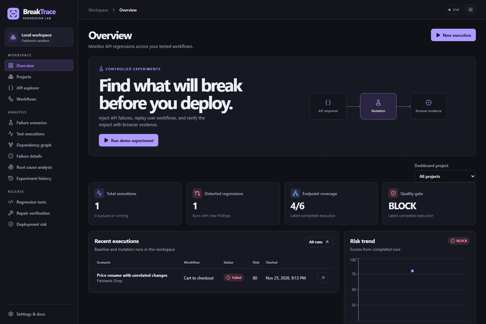
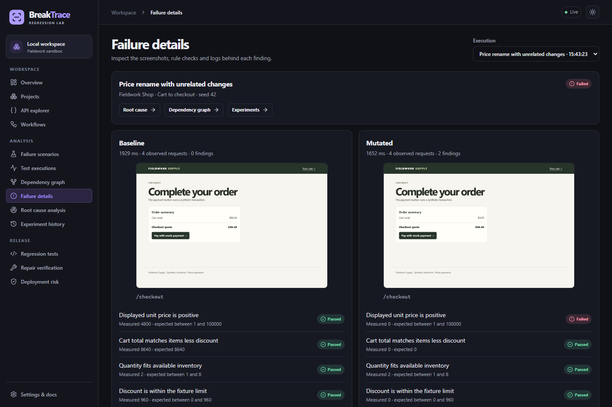
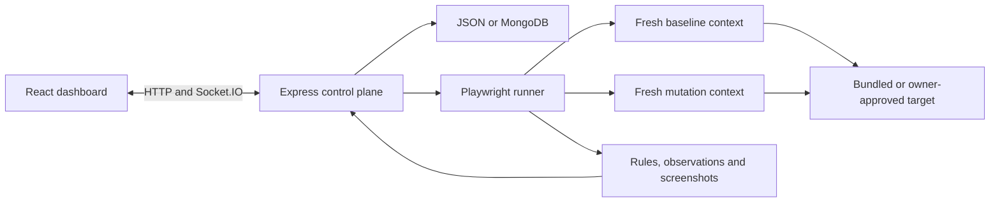

# BreakTrace

**A browser regression lab for API changes that break real workflows.**

BreakTrace replays a workflow in two fresh Chromium contexts, changes API responses in one, and compares what the user sees. The bundled Fieldwork Shop demo completes checkout with HTTP 200 and displays a zero total even though the independent checkout quote is 8,640 cents. BreakTrace detects the discrepancy, isolates the triggering mutation, exports a Playwright test, and checks a reviewed repair in a separate copy.



## Quick start

Install Node.js 24 and run from the repository root.

```sh
npm ci
npx playwright install chromium
npm run build
npm start
```

On Linux, install Chromium’s system dependencies with `npx playwright install --with-deps chromium`. Open `http://127.0.0.1:4311` and select **Run demo experiment**. JSON storage and the synthetic targets work without credentials or external services. For frontend development, run `npm run dev` and open port 5173. The Vite server proxies the API and Socket.IO to port 4311.

For the Compose image, start `docker compose up --build --wait` and use the same loopback URL. The workspace supports optional operator authentication and an optional MongoDB store. Copy [.env.example](.env.example) to `.env` to configure the options you use. The [deployment guide](DEPLOYMENT.md) covers private hosting, the MongoDB overlay, and current verification limits.

## Investigate a regression

1. In **Failure details**, compare the original and mutated browser results. Inspect the checkout total rule and screenshot evidence.
2. In **Experiment history**, inspect the trials that reduced three mutations to the price-field rename. Open **Dependency graph** to see the observed API and page relationships.
3. In **Regression tests**, export the generated Playwright spec. In **Repair verification**, approve the reviewed patch and inspect the rerun.
4. In **Deployment risk**, export JSON, HTML or PDF. The recorded JSON can drive the CLI gate.



The [three-minute demo](DEMO_SCRIPT.md) follows this workflow. The [demo guide](docs/DEMO_GUIDE.md) explains the individual evidence views.

## Features

- **Enroll owned applications.** Register an approved loopback or HTTPS staging origin, verify the proof file, and import OpenAPI 3.x JSON or YAML to find operations.
- **Record and author workflows.** Capture clicks and inputs, replay edited steps, and define rules against DOM values, captured API fields, or independent references.
- **Inject controlled response changes.** Configure shape, field, status, latency and transport mutations. Recheck findings against clean controls and repeated subsets.
- **Review evidence.** Inspect recorded API shapes and dependency graphs, generate Playwright specs, verify reviewed static repairs, and export JSON, HTML and PDF reports.
- **Store and integrate.** Keep records in JSON or MongoDB. Export GitHub issue, PR and Actions drafts. Deterministic analysis works offline, with optional Ollama, Gemini or OpenAI adapters.

To test your own application, set the exact origin in `BREAKTRACE_ALLOWED_ORIGINS` or `BREAKTRACE_ALLOWED_LOCAL_ORIGINS` before starting the API. In **Projects**, create the application and verify its challenge file. Register GET and HEAD operations, then use the recorder and scenario builder. External experiments change the browser response after forwarding the authorized read. [API reference](docs/API.md), [security model](SECURITY.md)

## Architecture



The control plane validates inputs, snapshots queued runs, and processes one browser job at a time. Baseline and variant compare structured finding signatures. The isolation pass reruns subsets in fresh contexts. Reports derive from the recorded run, and binary artifacts stay on disk in both storage modes.

**Stack** TypeScript, React, Express, Vite, Socket.IO, Playwright, Mongoose and MongoDB. [Architecture and execution details](ARCHITECTURE.md)

## Benchmarks

| Fixture | Outcomes | Isolation and generated specs |
| --- | --- | --- |
| Fieldwork Shop | 20 labeled regressions detected and 10 controls passed. Zero false positives, misses or indeterminate cases in this fixture set. | All 20 expected subsets matched. All 20 generated specs reproduced the failures, and both reviewed repair cases passed. |
| Room Board | Both labeled failures detected. The baseline and harmless label-removal controls passed. | Both expected subsets matched. The independently exercised baseline export passed and the capacity-rename export failed on the expected rule. |

These are curated synthetic workflows. The benchmark results describe those fixtures and the tested Chromium environment. [Benchmark methodology and evidence](BENCHMARK_RESULTS.md), [release verification](RELEASE_STATUS.md)

## Engineering checks

```sh
npm run lint
npm run build
npm test
npm run test:e2e
npm run smoke -- .data/smoke
npm run benchmark -- .data/fieldwork
npm run benchmark:rooms -- .data/rooms
```

Export `BREAKTRACE_TEST_MONGO_URI` for the optional integration against a disposable MongoDB instance. Apply the gate with `npm run gate -- .data/smoke/original.json`. Its expected exit code is 1 for BLOCK. The resilient report returns 0. Invalid or inconclusive evidence returns 2.

## Limits

- The workspace supports one operator. The private deployment keeps the app on loopback and uses an SSH tunnel and a workspace password. Shared accounts and project-level identities require a separate access model.
- Observed dependencies reflect executed workflows. The graph shows observed or inferred associations. Isolation is bounded and verifies single-removal minimality under the tested conditions.
- Chromium drives the experiments. Enrolled projects support scoped read-only upstream requests, test-ID workflows, and approved static repair snapshots.
- Live staging, model providers and GitHub metadata require operator-authorized configuration. Hosted deployment and container runtime evidence are tracked in the release status.

[Full limitations](LIMITATIONS.md) · [Release status](RELEASE_STATUS.md) · [Contributing](CONTRIBUTING.md) · [Interview guide](docs/INTERVIEW_GUIDE.md)
